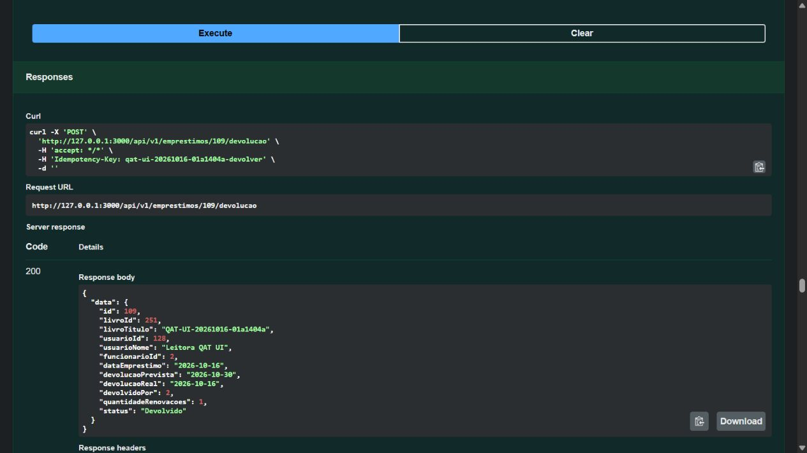

# Resultado do QAT das APIs — 16/10/2026

**Registro histórico do commit `5199ab5`.** A revisão posterior de perfil/localização tem [QAT próprio com 236 testes e 36 casos HTTP](qat-resultado-2026-10-16-frontend.md). Os resultados abaixo continuam associados à versão anterior.

**Resultado técnico: aprovado para integração local do frontend.** Não foi publicado em produção. O recebimento pela Bianca e a revisão humana do PR continuam sendo etapas de entrega, sem confirmação neste relatório.

Código testado: commit `5199ab59b1bb2d44fed9784f13e67a2e52c8171d`, branch `feature/livros`. Os testes foram executados no conteúdo que compõe esse commit; alterações posteriores deste relatório são documentação/evidências. O [checklist](qat-aceite-backend.md) define os casos e o [contrato](specs/2026-10-15-apis-restantes-design.md) define o comportamento. O [índice do workspace](../../relatorios/00-leia-primeiro.markdown) preserva o diagnóstico histórico.

## Evidências e método

| Verificação executada                        | Resultado                                                                                                 | Evidência                                                               |
| -------------------------------------------- | --------------------------------------------------------------------------------------------------------- | ----------------------------------------------------------------------- |
| Suíte completa, MySQL 8.4.11 local           | **214/214 em 23 arquivos**, sem falhas ou ignorados                                                       | [JSON Vitest MySQL](evidencias/qat-2026-10-16/vitest-mysql.json)        |
| Suíte completa, TiDB 8.5.3 local descartável | **214/214 em 23 arquivos**, sem falhas ou ignorados                                                       | [JSON Vitest TiDB](evidencias/qat-2026-10-16/vitest-tidb.json)          |
| QAT por HTTP real no MySQL                   | **32 casos, 109 requisições**, cobrindo as 23 operações; processo próprio e reinício real                 | [JSON HTTP MySQL](evidencias/qat-2026-10-16/http-mysql.json)            |
| Mesmo QAT HTTP no TiDB                       | **32 casos, 109 requisições**, aprovado                                                                   | [JSON HTTP TiDB](evidencias/qat-2026-10-16/http-tidb.json)              |
| MySQL, migrations 0001–0007                  | Histórico conferido; reexecução sem pendências                                                            | [Conferência MySQL](evidencias/qat-2026-10-16/migrations-mysql.json)    |
| TiDB vazio, migrations 0001–0007             | Instalação do zero aprovada; reexecução sem pendências; CHECK habilitado somente na instância descartável | [Conferência TiDB](evidencias/qat-2026-10-16/migrations-tidb.json)      |
| TypeScript backend                           | Build aprovado; também faz parte de `qat:http`                                                            | Comando `npm.cmd run build --prefix backend`                            |
| Angular                                      | Build de produção aprovado; código das telas não alterado                                                 | Comando `npm.cmd run build --prefix frontend`                           |
| Workflow                                     | Sintaxe aprovada por actionlint 1.7.12, sem ShellCheck/Pyflakes                                           | `.github/workflows/deploy-firebase.yml`; PR executa suíte e QAT HTTP    |
| Swagger/OpenAPI                              | 23 operações; referências resolvidas, com teste de contrato                                               | `dashboard.routes.test.ts`, mais conferência das 23 linhas do checklist |

O aceite funcional usa um cliente HTTP independente da suíte Supertest, com servidor real compilado, sessão, transações e banco real. Esse método executa automaticamente os cenários originalmente propostos para conferência manual. A validação visual do Swagger abaixo é complementar. **Não se afirma que uma pessoa clicou manualmente em todas as 23 operações.**

Os relatórios HTTP registram método, caminho, status, erro, IDs e paginação, sem senhas ou cookies. As fixtures próprias foram removidas ao final; dados preexistentes foram preservados. Os relatórios Vitest contêm os nomes e resultados individuais dos testes. As duas baterias não são testes de carga nem auditoria completa de segurança.

## Cobertura das operações

API-01–23: **aprovadas por HTTP real nos dois bancos**. Cada ID aparece no campo `casos` dos relatórios HTTP e suas requisições no campo `requisicoes`. Incluem sessão/perfil, cadastro de funcionário, CRUD de livros, leitores/histórico, empréstimos/renovações/devoluções, dashboard e pendências. A suíte complementa as combinações de filtros, validações e concorrência.

## Cobertura das regras

| Caso do checklist                                      | Resultado e comprovação                                                                                                                                                       |
| ------------------------------------------------------ | ----------------------------------------------------------------------------------------------------------------------------------------------------------------------------- |
| REG-01 — três empréstimos e liberação após devolução   | AP: caso HTTP REG-01 e teste `limita a três abertos por leitor e volta a permitir após devolução`                                                                             |
| REG-02 — duas renovações, +7 dias sobre prazo anterior | AP: HTTP API-20 e teste `vencimento hoje pode ser renovado; prazo cresce sete dias sobre o anterior, no máximo duas vezes`                                                    |
| REG-03 — bloqueio por atraso e liberação               | AP: HTTP REG-03; suíte bloqueia também renovação de outro empréstimo em dia                                                                                                   |
| REG-04 — saldo, manutenção e indisponibilidade         | AP: HTTP API-07/10/17/21 e REG-07; suíte verifica manutenção total e estoque comprometido                                                                                     |
| REG-05 — inativação, reativação e histórico            | AP: HTTP REG-05a/API-11; suíte de leitores confirma reativação e preservação do histórico                                                                                     |
| REG-06 — idempotência e headers                        | AP: HTTP REG-06/API-20/API-21; suíte cobre chave ausente/inválida, corpo divergente, isolamento por funcionário e repetição concorrente                                       |
| REG-07 — concorrência                                  | AP: HTTP REG-07 disputa último exemplar; suíte cobre limite global em livros diferentes, renovação/devolução e inativação concorrentes                                        |
| REG-08 — datas da escola e campos do servidor          | AP: HTTP API-17/API-20; 11 testes em `utils/datas.test.ts`, incluindo meia-noite de São Paulo, anos bissextos e vencimento hoje                                               |
| REG-09 — reinício e persistência                       | AP: HTTP REG-09 reinicia o processo e repete cadastro/renovação com as chaves originais; sessão e estado persistem                                                            |
| REG-10 — unicidade e PATCH                             | AP: HTTP API-10/12/15/API-11; suíte de livros testa ISBN normalizado/único inclusive inativo; leitores testam matrícula de inativo                                            |
| REG-11 — indicadores e relatório                       | AP: HTTP API-22/API-23/API-21; suíte concilia abertos, atrasados, vencimentos hoje, leitores e unidades                                                                       |
| REG-12 — filtros e paginação                           | AP: HTTP API-13/16/18/23 e REG-12; suítes verificam busca literal, filtros, intervalos e histórico restrito ao leitor correto                                                 |
| REG-13 — autenticação e conta inativa                  | AP: HTTP API-02/REG-13; suíte `funcionário inativado perde a sessão existente em todas as APIs`                                                                               |
| REG-14 — erros estruturados                            | AP: HTTP REG-14 e `http/erros.test.ts`: JSON inválido 400, excesso 413, charset/compactação não suportados 415, erro inesperado 500 genérico; validações 422 em várias suítes |

## Conferência pelo navegador

Executada pelo Codex no Swagger em `http://127.0.0.1:3000/api/docs/`, com controles reais da página:

1. Antes de autenticar, consulta de livros respondeu 401.
2. Login local respondeu 200; `/me` respondeu 200 usando o cookie do navegador.
3. Livro com quantidade zero respondeu 422 com indicação do campo; cadastro válido respondeu 201, ID 251, duas unidades disponíveis.
4. Leitor exclusivo da rodada foi cadastrado com 201, ID 128.
5. Empréstimo com `Idempotency-Key` respondeu 201, ID 109, data 16/10 e vencimento 23/10.
6. Renovação respondeu 200, contador 1 e vencimento 30/10, sete dias sobre o anterior.
7. Devolução respondeu 200, `Devolvido`, data 16/10 e operador registrado.
8. Logout respondeu 204; a mesma página `/me` passou a responder 401.



Livro, leitor, empréstimo, renovação e as três chaves exclusivas dessa prova visual foram removidos depois da captura. A limpeza validou os IDs e identificadores da rodada antes de remover; a conta de desenvolvimento foi preservada.

## Defeitos encontrados e resolvidos

| ID      | Antes                                                                                                                        | Correção e reteste                                                                                                                                                   |
| ------- | ---------------------------------------------------------------------------------------------------------------------------- | -------------------------------------------------------------------------------------------------------------------------------------------------------------------- |
| QAT-001 | `PATCH /me` com nome de 121 caracteres chegava ao MySQL e retornava 500                                                      | Limite de 120 no schema e Swagger; agora 422, sem mudar o perfil. Testes verificam rejeição de 121 e aceitação de 120                                                |
| QAT-002 | Charset/compactação de conteúdo não suportados retornavam 500                                                                | Handler reconhece os erros do parser e devolve 415 estruturado; dois testes reproduziram a falha e passaram após correção                                            |
| QAT-003 | Não havia evidência explícita de 413 e 500 genérico                                                                          | Acrescentados testes na aplicação real, inclusive falha controlada no banco para provar ausência de SQL/credenciais na resposta; teste seguinte confirma recuperação |
| QAT-004 | Descrição do Swagger dizia que as APIs de negócio ainda não estavam completas; roteiro de senha mandava apagar sessões/conta | Descrição e roteiros atualizados; teste usa conta exclusiva e restauração por API, sem apagar sessões de outras pessoas                                              |
| QAT-005 | Fluxo HTTP completo só existia em script temporário desta máquina                                                            | Comando versionado `npm run qat:http --prefix backend`; CI passa a executar o mesmo fluxo com dados descartáveis                                                     |

Nenhum defeito crítico/alto aberto foi identificado nesta rodada dentro do escopo das APIs locais. O código, as migrations, as regras transacionais e os contratos foram revisados pelo próprio agente; isso não substitui revisão independente do PR.

## Reprodução e entrega

O [guia para Bianca](entrega-backend-bianca.md) reúne checkout, configuração local, contrato e cuidados de integração. Para repetir a validação no host, com dependências do backend instaladas e MySQL local pronto:

```powershell
npm.cmd ci --prefix backend
npm.cmd run dev:migrate
npm.cmd test --prefix backend
npm.cmd run qat:http --prefix backend
```

`qat:http` compila, inicia um processo próprio em `127.0.0.1:3007`, testa, reinicia, remove as próprias fixtures e grava `tmp/qat-http.json`. Recusa `NODE_ENV=production`, host de banco diferente de `127.0.0.1` e socket externo. `DB_*` define o banco local de teste; `QAT_PORT`/`QAT_OUTPUT` permitem escolher porta e saída. Use instâncias locais destinadas a teste.

O PR para `feat/backend-foundation` deve mostrar o resultado do CI da versão revisada. O job de publicação fica fora dos eventos de PR. Merge/push na branch de destino tem efeito de publicação e exige as verificações cloud previstas no QAT; não foi realizado nesta entrega.

Pendências fora deste aceite: integração das telas pela Bianca; sessão/guards/logout e testes já falhos do Angular; CSRF completo e limitação de login; configuração CHECK e homologação na URL do TiDB Cloud/serviço publicado. A rodada aprova as APIs **para integração local**, sem declarar o sistema completo homologado ou seguro para publicação.
